# Виджеты · Redheadesign

[Открыть витрину](https://redheadesign.com/widgets/) · [Скачать релиз](https://github.com/redheadesign/widgets/releases/latest/download/widgets-kit.zip) · [Подключить React](docs/library.md) · [Отправить в Telegram](docs/telegram.md)

30 интерактивных компонентов React для сайтов, дашбордов и bento-сеток. В студии можно менять размер, цвет и движение карточки, проверить вариант для Telegram и забрать HTML или iframe. Экспорт для Telegram работает как отдельный HTML-виджет внутри сообщения бота в личном чате.

На витрине 29 карточек, в том числе два эксперимента, Компас и Луна. Сетка подстраивается от одной до трёх колонок, а раскладка и палитра меняются при открытии. Можно фильтровать карточки по теме и пользоваться их управлением прямо на странице.

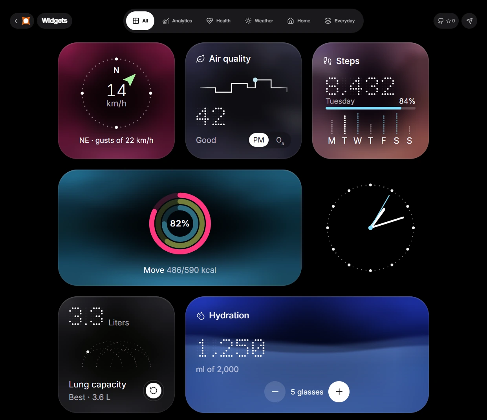

<details>
<summary>Витрина на телефоне</summary>

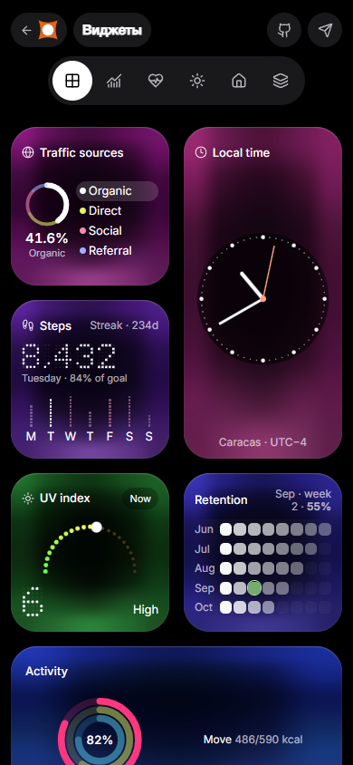

</details>

## Каталог в картинках

### Аналитика

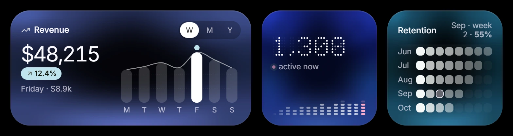
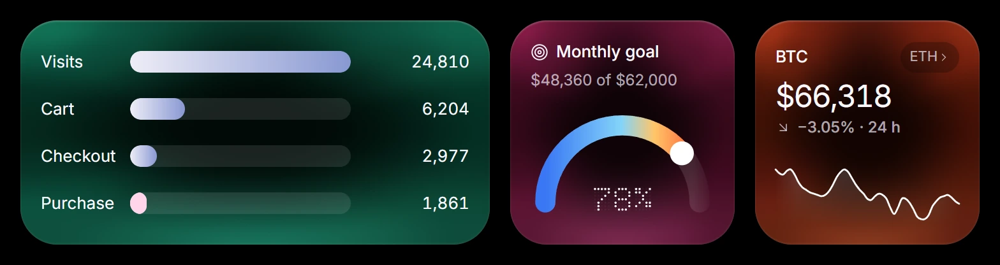

### Здоровье и привычки

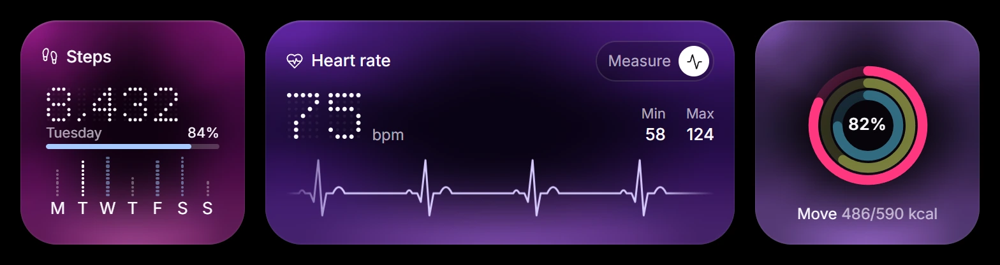
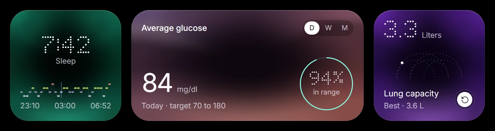
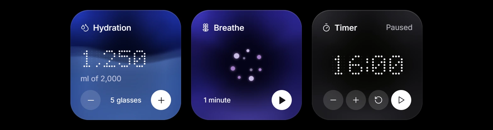

### Погода

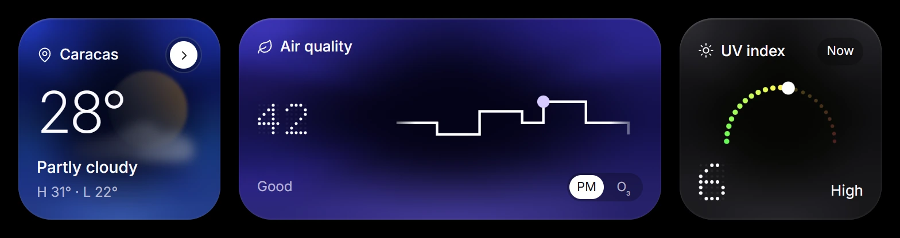
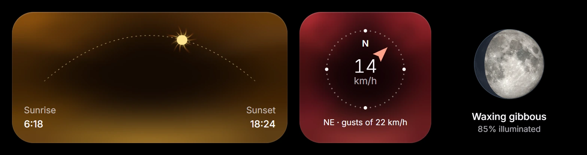

### Дом и навигация

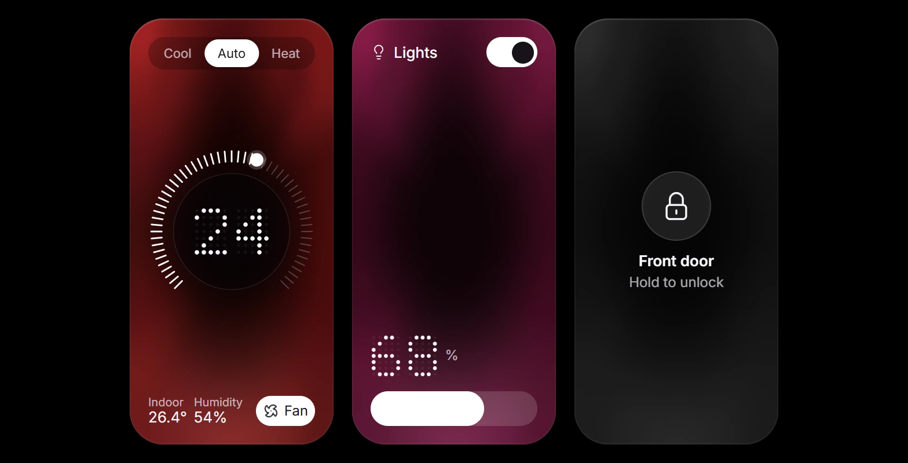
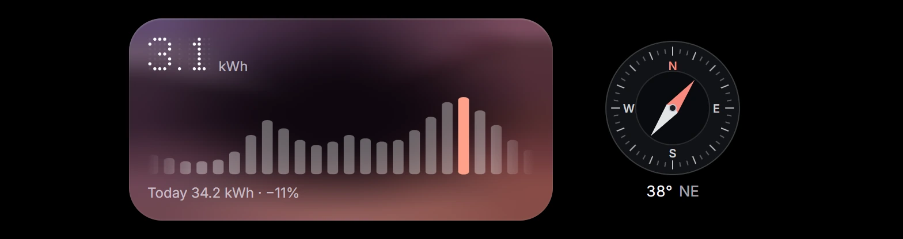

### На каждый день

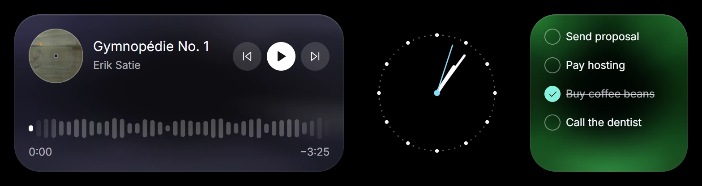

<details>
<summary>Ещё три компонента из студии</summary>

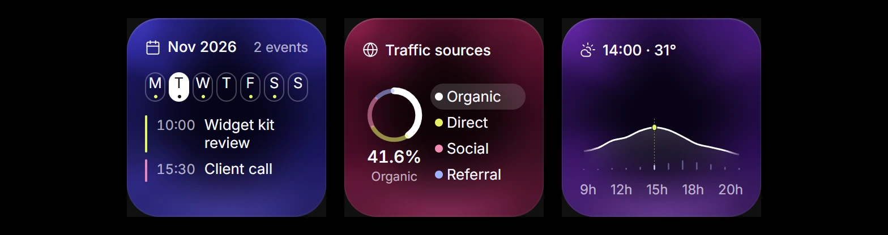

</details>

## Запустить студию

Нужен Node.js 22.18+ или 24 LTS.

```sh
npm ci
npm run dev -- --host 127.0.0.1
```

- [Студия](http://127.0.0.1:5173/) — каталог, предпросмотр и экспорт.
- [Витрина](http://127.0.0.1:5173/widgets/) — интерактивная сетка с фильтрами по категориям.
- [Отдельный виджет](http://127.0.0.1:5173/?embed=hydration) — прозрачный фон для iframe. Контейнер iframe задаёт его ширину и высоту.

## Подключить к React

Для React 19 используйте пакет из последнего релиза:

```sh
npm install https://github.com/redheadesign/widgets/releases/download/v1.0.3/redheadesign-widgets-1.0.3.tgz
```

Чтобы взять текущую версию из `main`, клонируйте репозиторий и запустите `npm ci` и `npm pack`. Установите полученный `.tgz` в приложении.

Подключите стили один раз в точке входа приложения:

```tsx
import { Widget } from '@redheadesign/widgets';
import '@redheadesign/widgets/style.css';

export function Dashboard() {
  return <div style={{ height: 176 }}><Widget id="hydration" fill /></div>;
}
```

`size="small"`, `"wide"` или `"large"` задаёт номинальный формат 1 × 1, 2 × 1 или 2 × 2. Для адаптивной сетки используйте `fill` и задайте размер родителю. Рекомендуемый минимум — 160 × 160 px. [Параметры, каталог и примеры](docs/library.md).

## Отправить через бота Telegram

Скачайте HTML из студии или сгенерируйте его через `buildTelegramHtml('hydration')` из `@redheadesign/widgets/telegram`. Пользователь должен открыть личный чат с ботом и нажать «Старт». Затем бот передаёт HTML и `chat_id` методу `sendWidget`. [Пример отправки и ограничения HTML](docs/telegram.md).

## Собрать и проверить

```sh
npm run build
npm run check:library
npm run check:telegram -- --exact --write
```

Сайт собирается в `dist/`. Отдельные HTML для `sendWidget` сохраняются в `telegram-dist/`. Для `--exact` нужен Python 3. [Ограничения Telegram и пример отправки](docs/telegram.md).

При запущенной студии `npm run qa:landing` проверяет геометрию, фильтры и рандомизацию витрины в Edge. `npm run qa:web` запускает основные действия всех веб-карточек в трёх форматах.

Карточки здоровья, погоды, аналитики и умного дома используют демонстрационные данные. Плеер воспроизводит пять записей CC0 на вебе. [Источники аудио, обложек и шрифта](ATTRIBUTION.md) · [Снимок Луны NASA SVS](src/widgets/astronomy-assets/ATTRIBUTION.md)
